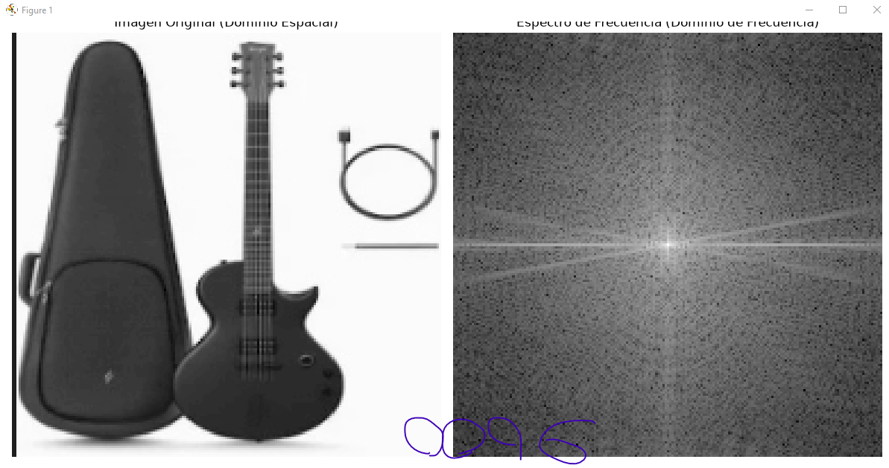
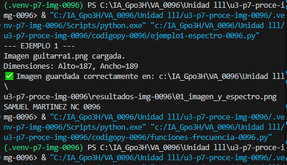
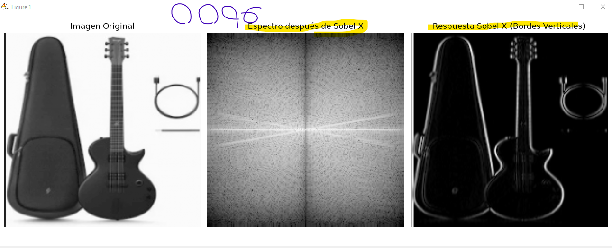
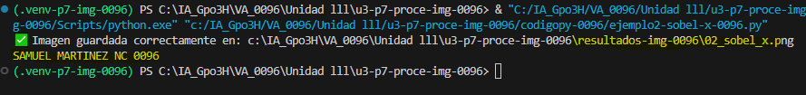
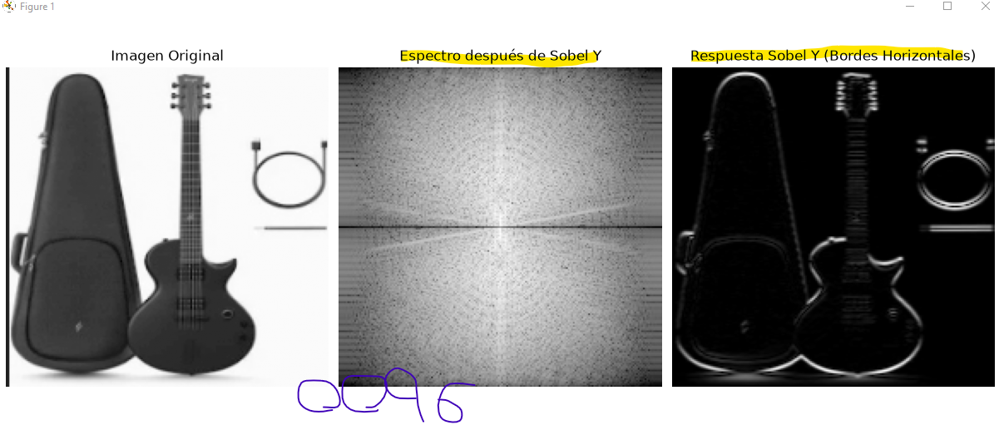
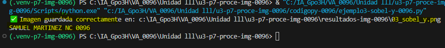
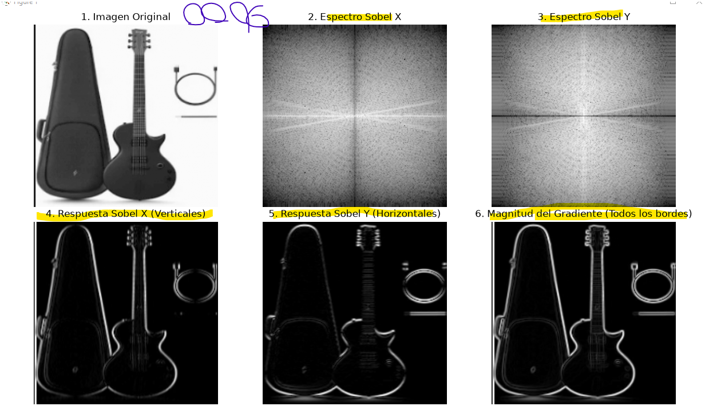

## PROPOSITO

## IMAGEN ORIGINAL

## EJEMPLO 1: IMAGEN ORIGINAL Y ESPECTRO DE FRECUENCIA

## EJEMPLO 2: SOBEL X EN EL DOMINIO DE LA FRECUENCIA

## EJEMPLO 3: SOBEL Y EN EL DOMINIO DE LA FRECUENCIA

## EJEMPLO 4: MAGNITUD DEL GRADIENTE (SOBEL X + SOBEL Y)
